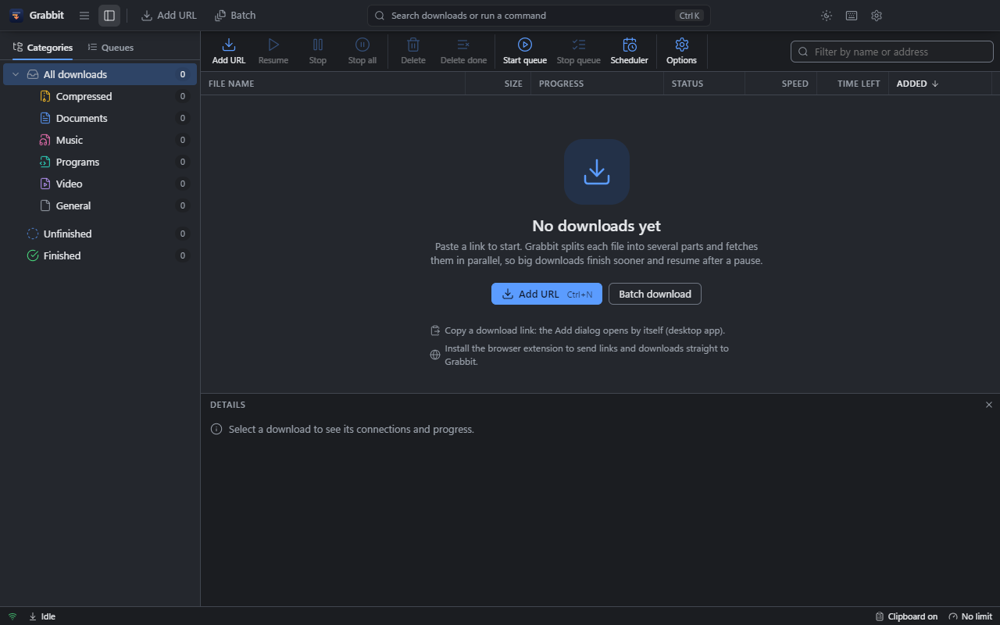

<p align="center">
  
</p>

<h1 align="center">Grabbit</h1>

<p align="center"><strong>Grab files faster.</strong><br>
An IDM-style download manager for Windows, macOS and Linux.</p>

<p align="center">
  <a href="../../releases/latest"><b>Download the latest release</b></a> ·
  <a href="../../releases">All releases</a>
</p>

Files are split into parts and downloaded over several connections at once, then paused, resumed, queued and
scheduled.



## Install

From the [latest release](../../releases/latest):

- **Windows:** `Grabbit-Setup-<version>.exe`
- **macOS (Apple silicon):** `Grabbit-<version>-mac-arm64.dmg`
- **Linux:** `Grabbit-<version>-x86_64.AppImage`
- **Browser extension:** `Grabbit-Extension-Chrome-<version>.zip`, `…-Edge-…` and `…-Firefox-…`. See
  [browser extensions](docs/browser-extensions.md) for how to install them.

The builds are not code-signed yet. On Windows, SmartScreen may warn on first run: choose **More info → Run anyway**. On
macOS, right-click the app and choose **Open** the first time.

The structure and UI follow [Rowlit](https://github.com/hadirajabi80/rowlit): an Electron shell, a React UI and a
separate engine process that the UI reaches over local HTTP and WebSocket. The UI uses the same design tokens and layout:
a glass top bar, a tabbed dock on the left, a toolbar, a status bar and a command palette.

## Features (IDM parity)

| IDM | Grabbit |
| --- | --- |
| Dynamic file segmentation | Up to 32 connections per file. When a connection finishes, it takes over half of the largest part still downloading. |
| Resume | Pause or quit at any time. Each part's progress is saved, so downloads continue after a restart. Servers without Range support fall back to one connection. |
| Refresh download address | Paste a new link in **Properties** when one expires. The downloaded bytes are kept. |
| Error recovery | Each connection retries with a delay. 4xx errors fail at once, and an expired redirect target is requested again from the original address. |
| Categories | General, Compressed, Documents, Music, Programs and Video, each saved to its own folder. |
| Queues and scheduler | Several queues, each with a limit on files at once, start and stop times, and days of the week. |
| Speed limiter | A global limit (toggle it from the status bar) and a limit per download. |
| Batch download | Paste a list of links, or use a `*` wildcard pattern over numbers or letters with zero-padding. |
| Site grabber | **Batch → Website** reads a page, and the pages it links to up to three levels deep, and lists the files of the types you choose. |
| Video grabber | Paste a YouTube, Vimeo or other video page (yt-dlp knows about 1,800 sites) and pick the quality, or audio only. yt-dlp is downloaded on first use and kept up to date; FFmpeg joins video and audio. |
| FTP and SFTP | `ftp://` and `sftp://` addresses, with several connections and resume. SFTP uses a password, the SSH agent or your key, and checks the server's host key. |
| Site logins | HTTP Basic and Digest. Grabbit asks when a site wants a login and saves it encrypted (Options → Site logins). |
| Proxy | The system proxy, or an HTTP or SOCKS5 proxy with a login, with a list of addresses that bypass it. |
| After download | Checksum check (MD5, SHA-1, SHA-256, SHA-512), virus scan (Microsoft Defender or your scanner), open the file, and extraction of ZIP, 7z and RAR (multi-part and password-protected too) with 7-Zip, downloaded on first use. |
| When done | Quit, sleep, hibernate or shut down when all downloads finish, after a one-minute warning you can cancel. |
| Browser integration | Extensions for **Chrome**, **Edge** and **Firefox**: **Download with Grabbit**, **Download selected links** and **Download all links** in the right-click menu, and browser downloads of captured file types are handed to the app, cookies included. See [browser extensions](docs/browser-extensions.md). |
| Clipboard monitoring | Copying a download link opens the Add dialog (desktop app). |
| Duplicate handling | Renames to `file (1).zip`, or overwrites. |
| Completion | A toast with **Open** and **Open folder**, a native notification, and taskbar progress. |
| Tray | Closing the window keeps the app running in the tray, and downloads continue. |
| Automatic updates | Checks GitHub Releases at start and every 6 hours. On Windows and the Linux AppImage the update downloads in the background and installs with **Restart to update** (or on quit). Unsigned macOS builds show the new version with a link. |

## Getting started

Requires Node.js 20+.

```bash
npm run setup
```

```bash
npm start
```

`npm start` builds the engine, the UI and the desktop shell, then launches the app.

For development:

```bash
npm run dev
```

This runs the engine (token `dev`) plus Vite. Open http://localhost:5173 in a browser. The engine uses port 7310, or a
free port when an installed Grabbit already holds 7310, and the UI is pointed at it. Development state lives in
`.dev-data/`, separate from the installed app.

```bash
npm run dev:desktop
```

This runs Vite and opens Electron on it.

To build an installer (NSIS on Windows) under `desktop/release/`:

```bash
npm run dist
```

To try it without the internet, start the local test server, then add e.g.
`http://127.0.0.1:7400/files/big.iso?mb=200&kbps=800`. It supports Range requests, caps the speed of each connection,
and has `/norange/`, `/redirect/` and `/expired/` variants, plus a `/page` of links for the extension's "Download all
links".

```bash
npm run test-server
```

To run the engine tests (segmentation, pause/resume, no-Range fallback, retries, queues, speed limit):

```bash
npm test
```

### Browser extensions

```bash
npm run build:extensions
```

This builds the Chrome, Edge and Firefox extensions into `extension/dist/`. To try one, load `extension/dist/chrome`
(or `edge`) with **Load unpacked** in `chrome://extensions`, or load `extension/dist/grabbit-firefox-<version>.zip` in
Firefox's `about:debugging`. [docs/browser-extensions.md](docs/browser-extensions.md) covers installing and publishing to
the Chrome Web Store, Edge Add-ons and addons.mozilla.org.

The extension talks to the app on `127.0.0.1:7310/capture`. The engine accepts only requests that carry an
`X-Grabbit-Capture` header and no web-page origin, so web pages cannot use it.

## Layout

```
engine/      Node download engine (sidecar): HTTP API + WebSocket events
  src/core/  DownloadTask (segments, splitting, retries), DownloadManager (queues, scheduler,
             persistence, progress), limiter, http (auth), proxy, secrets (encrypted logins),
             sources/ (HTTP, FTP, SFTP), post (checksums, scan, power actions), extract (7-Zip),
             tools (7-Zip, yt-dlp, FFmpeg on first use), video (yt-dlp), grabber, categories, settings
  src/http/  REST routes, /ws events, /capture for the extension
  test/      integration tests against a local Range-capable server
ui/          React + Vite + zustand + lucide (Rowlit's structure)
  src/app/        command registry (toolbar, menus, palette and shortcuts share it), boot, keys
  src/api/        REST client, WebSocket with reconnect
  src/store/      downloads, engine config, ui
  src/components/ layout (TopBar, Dock), Toolbar, DownloadList (virtualized), DetailsPane (segment map,
                  connections), AddDownload, Batch, Properties, Queues (scheduler), Settings,
                  CommandPalette, StatusBar, common (Dialog, Menu, Toasts, Splitter)
  src/theme/      tokens.css (light/dark), app.css
desktop/     Electron main + preload: starts the engine as a utility process, window, tray,
             clipboard watcher, notifications, folder picker
extension/   browser extension: one source (src/) for Chrome, Edge and Firefox
shared/      protocol.ts: wire types shared by the engine and the UI
scripts/     run.mjs (dev and start launchers), build-extensions.mjs, test-server.mjs (HTTP on 7400, FTP on 7421)
```

## Keyboard

| Shortcut | Action |
| --- | --- |
| Ctrl+N / Ctrl+Shift+N | Add URL / Batch download |
| Ctrl+K | Command palette (search downloads, run commands) |
| Space / Enter / Del | Resume or stop / Open / Delete (in the list) |
| Alt+Enter | Properties |
| Ctrl+B / Ctrl+J | Toggle side panel / details pane |
| Ctrl+Shift+S | Scheduler |
| Ctrl+, | Options |
| Ctrl+/ | All shortcuts |

## Releasing

Set the new version in `desktop/package.json`, add `docs/release-notes/v<version>.md`, then push a matching tag:

```bash
git tag v1.0.1
```

```bash
git push origin v1.0.1
```

The Release workflow builds the Windows, macOS and Linux packages on GitHub's runners and publishes them as a GitHub
Release. CI typechecks and tests every push to `main`.

## Not included (yet)

Signed builds, macOS Intel builds, a floating drop target, and FTPS (FTP over TLS).

## License

[MIT](LICENSE)
